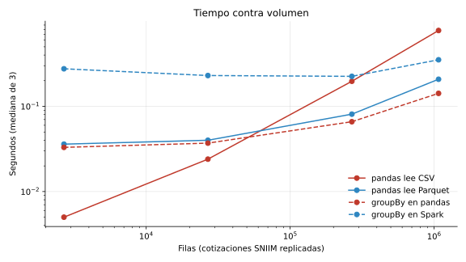

# Comparación de desempeño

```bash
python -m src.processing.benchmark --factores 1 10 100 400
```

El código está en `src/processing/benchmark.py`. Los resultados quedan en
`reports/tables/desempeno.csv` y `reports/figures/desempeno_volumen.svg`.

## Cómo medimos

- **Volumen.** Nuestro dataset real es chico. Para ver qué pasa al crecer, replicamos
  las cotizaciones procesadas del SNIIM 1, 10, 100 y 400 veces (de 2,683 a 1,073,200
  filas) y revolvemos el orden. Las filas son reales; solo se repiten.
- **Tiempo.** Mediana de 3 corridas con `time.perf_counter()`. En Spark hacemos una
  corrida de calentamiento antes de medir.
- **Memoria de pandas.** Cada prueba corre en un proceso de Python aparte; reportamos su
  pico de memoria menos lo que pesa el proceso con las librerías ya importadas.
- **Memoria de Spark.** Vive en la JVM, fuera de Python; no la medimos aquí (n/d).
- **Resultado.** Comprobamos que pandas y Spark dan exactamente el mismo `groupBy`
  (conteo y promedio por variedad) y que ambas lecturas devuelven todas las filas.

Equipo: contenedor Linux con 2 núcleos, Spark 4.0 en `local[*]`, pandas 2.3, pyarrow 26. En otra máquina los segundos cambian; lo que importa es la forma de las curvas.

## Resultados

### A. Lectura: CSV vs Parquet (pandas)

| Filas | CSV (MB) | Parquet (MB) | CSV (s) | Parquet (s) | RAM CSV (MB) | RAM Parquet (MB) | Resultado |
|---|---|---|---|---|---|---|---|
| 2,683 | 0.15 | 0.02 | 0.005 | 0.036 | 0.0 | 1.7 | Correcto |
| 26,830 | 1.48 | 0.13 | 0.024 | 0.040 | 0.0 | 18.3 | Correcto |
| 268,300 | 14.84 | 1.30 | 0.197 | 0.081 | 14.1 | 63.2 | Correcto |
| 1,073,200 | 59.35 | 5.19 | 0.777 | 0.208 | 130.8 | 185.9 | Correcto |

### B. Agregación: pandas vs Spark (mismo `groupBy` sobre Parquet)

| Filas | pandas (s) | Spark (s) | RAM pandas (MB) | Resultado |
|---|---|---|---|---|
| 2,683 | 0.033 | 0.276 | 0.9 | Correcto |
| 26,830 | 0.037 | 0.230 | 9.5 | Correcto |
| 268,300 | 0.066 | 0.225 | 22.4 | Correcto |
| 1,073,200 | 0.142 | 0.352 | 83.9 | Correcto |

### C. Filtrar un mes: Parquet sin particionar vs particionado por mes (Spark)

| Filas | Sin particionar (s) | Particionado (s) | Plan del particionado |
|---|---|---|---|
| 2,683 | 0.117 | 0.088 | `PartitionFilters` |
| 26,830 | 0.094 | 0.242 | `PartitionFilters` |
| 268,300 | 0.088 | 0.092 | `PartitionFilters` |
| 1,073,200 | 0.100 | 0.072 | `PartitionFilters` |

### D. Particiones de shuffle (1,073,200 filas, `groupBy` estado × variedad)

| Particiones | Segundos | Grupos |
|---|---|---|
| 4 | 0.031 | 19 |
| 8 | 0.031 | 19 |
| 16 | 0.028 | 19 |



## Qué aprendimos

**¿Qué operación medimos?** Lectura de un archivo completo, una agregación por grupo, un
filtro por periodo y la misma agregación con distinto número de particiones de shuffle.

**¿Qué cambió?**

1. **Parquet gana al crecer, CSV gana en archivos diminutos.** Con 2,683 filas el CSV se
   lee 7 veces más rápido: abrir un Parquet tiene un costo fijo (leer metadatos,
   esquema, arrancar pyarrow). Las curvas se cruzan cerca de las 50 mil filas, y con un
   millón Parquet ya es **3.7 veces más rápido** y ocupa **11 veces menos** en disco.
   El CSV tiene que convertir texto a número fila por fila; Parquet ya guarda el tipo.
2. **Parquet ocupó más RAM al leer, no menos.** Esperábamos lo contrario. pyarrow carga
   las columnas en sus propios buffers y luego las convierte a pandas: por un momento
   existen las dos copias. El ahorro de Parquet es en disco y en tiempo, no en el pico
   de memoria de pandas. Además, el tamaño en disco que medimos es **optimista**: como las
   filas se repiten, el diccionario de Parquet comprime más de lo que comprimiría con
   datos reales.
3. **pandas le gana a Spark en todos nuestros volúmenes.** Spark tarda ~0.23 s aunque haya
   2 mil filas: es el costo fijo de planear la consulta, listar archivos y coordinar
   tareas en la JVM. pandas crece casi lineal (0.03 → 0.14 s) y Spark casi plano
   (0.23 → 0.35 s). Con nuestros datos, Spark no se justifica por velocidad.
4. **El particionado casi no se nota a este tamaño.** El plan sí confirma que Spark
   ignora las demás carpetas (`PartitionFilters`), pero `count()` sobre Parquet ya es
   muy barato porque Spark puede usar los metadatos de cada archivo. Con 1 millón de
   filas el particionado fue 28% más rápido; en volúmenes chicos la diferencia es ruido
   (más archivos que abrir).
5. **4, 8 o 16 particiones de shuffle dan lo mismo.** Spark 3+ tiene *Adaptive Query
   Execution*: después del shuffle junta particiones vacías por su cuenta. Con 19 grupos,
   casi todas las particiones están vacías sin importar cuántas pidamos.

**¿Qué pasaría con un volumen mayor?** Extrapolando las curvas: pandas lee y agrega en
memoria, así que su tiempo y su RAM crecen con los datos. Con el histórico completo del
SNIIM (todas las frutas y hortalizas, 2010–2025) o con el SIAP de todos los cultivos sin
filtrar (unos 6 MB por año, ~80 MB en total), pandas sigue bastando. El punto donde
Spark empieza a ganar es cuando el dataset deja de caber cómodo en la RAM de una
máquina: ahí Spark procesa por particiones y pandas truena. Por eso mantenemos el
pipeline en Spark —que es lo que pide el curso y nos deja crecer sin reescribir— pero
somos honestos: **a nuestro volumen actual, el formato (Parquet) y el particionado
importan más que el motor**.
